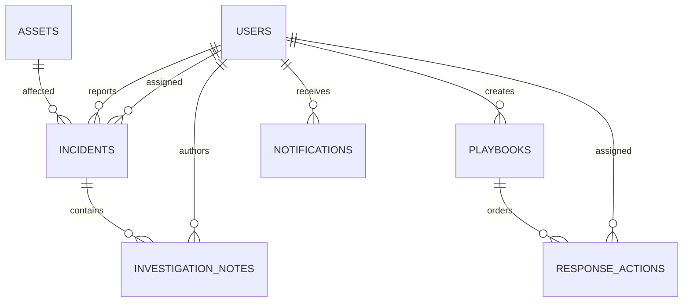

# Services 3, 8 and 9 — Jad Moharam

## Authentication, responses and errors

Every user request requires `Authorization: Bearer <JWT>` issued using the shared Omar helpers. Requests verify signature/expiry and the stored user's active status/current role. Notification creation additionally accepts an authorized `X-Service-Key` for other services. No client role header or JSON role field grants access.

Success: `{"status":"success","message":"...","data":...}`. List endpoints return `data` as an array and `count` at the top level. Mutation responses additionally contain `warnings`, an array; an empty array indicates no known pending side effects for that service. Errors: `{"status":"error","message":"..."}`.

200: read/update/delete; 201: created; 400: invalid body, values or workflow; 401: missing/invalid/stale identity; 403: denied role/ownership; 404: missing resource; 409: duplicate/conflicting state; 503: missing schema or required audit dependency unavailable. Malformed JSON, arrays, empty bodies and unknown fields are rejected on body endpoints. Text is trimmed and length/control-character checked. SQL values are always bound parameters.

Dates are server UTC ISO 8601 strings unless a valid past timezone-aware completion timestamp is explicitly supplied. Server-only IDs, creator identity, default status and creation timestamps cannot be injected in JSON.

## Service 3 — Incident Management, port 5003

| API | Roles | Request / result |
|---|---|---|
| POST /incidents | Admin, User | Required title, description, category, severity, asset_id; optional reporter_id. User may report only for self. Returns complete incident, 201. |
| GET /incidents | Admin, Auditor | No body. List of incident records, including status and assignee. |
| GET /incidents/{id} | Admin, Analyst, User, Auditor | Analyst assigned only; User own reports only. Returns incident including notes array. |
| PUT /incidents/{id}/assign | Admin | analyst_id, a positive integer identifying an active Security Analyst. Returns updated incident; sends assignment notification. |
| PUT /incidents/{id}/status | Admin, Analyst | status. Analyst assigned only. Returns updated incident; resolution time set on Resolved. |
| POST /incidents/{id}/notes | Admin, Analyst | content. Analyst assigned only; note author is authenticated user. Returns note record, 201. |

Example create:

```json
{"title":"Suspicious email","description":"Investigate sender","category":"Phishing","severity":"High","asset_id":1}
```

Status request: `{"status":"Under Investigation"}`. Assignment request: `{"analyst_id":2}`. Note request: `{"content":"Headers preserved"}`.

Fields: incident_id, title, description, category, severity, reporter_id, asset_id, assigned_analyst_id, status, created_at, resolved_at. New incidents are Open and unassigned. Notes contain note_id, incident_id, analyst_id, content, created_at.

Severity: Low, Medium, High, Critical. Categories: Malware, Phishing, Unauthorized Access, Account Compromise, Data Leakage, Denial of Service, Other. The category vocabulary is a team convention based on the assignment examples.

Only Open -> Under Investigation -> Mitigated -> Resolved -> Closed is accepted. Skips, reversals and repeated statuses return 400. Same analyst assignment returns 409; closed incidents cannot be reassigned. The required affected asset and reporter must exist. The API does not expose the organization's asset list to regular users.

## Service 8 — Notification and Alert Management, port 5008

| API | Roles | Request / result |
|---|---|---|
| POST /notifications | Admin, authorized services | Required user_id, title, message, type, severity. Returns notification, 201. |
| GET /notifications/user/{user_id} | Admin, Analyst, User, Auditor | Analyst/User own only. Returns list; existing user with none returns 200 and empty array. |
| GET /notifications/{id} | Admin, Analyst, User, Auditor | Analyst/User own only. Returns one notification. |
| PUT /notifications/{id}/read | Admin, Analyst, User | No body. Analyst/User own only. Sets Read/read_at; repeated calls preserve first read time. |
| GET /notifications/search | Admin, Analyst, Auditor | Optional user_id, type, severity, status query filters combined with AND. Analyst always restricted to self. |
| DELETE /notifications/{id} | Admin | No body. Deletes and returns notification_id. |

Example create:

```json
{"user_id":2,"title":"Incident assigned","message":"Investigate incident 1","type":"Incident Assignment","severity":"High"}
```

Types: Incident Assignment, Security Alert, System Notification, Threat Alert, Vulnerability Alert. Severity uses Low/Medium/High/Critical as a documented team proposal. Status starts Unread with read_at null, then becomes Read. Invalid types or filters return 400; unauthorized cross-user requests return 403.

Search example: `/notifications/search?user_id=2&severity=High&status=Unread`. Unknown or repeated query parameters are rejected. Response fields: notification_id, user_id, title, message, type, severity, status, created_at, read_at.

## Service 9 — Playbooks and Response Automation, port 5009

| API | Roles | Request / result |
|---|---|---|
| POST /playbooks | Admin | Required name, description, incident_category, severity. Returns playbook, 201. |
| GET /playbooks | Admin, Analyst, Auditor | List of playbook records. |
| GET /playbooks/{id} | Admin, Analyst, Auditor | Playbook plus ordered actions, per-action history and progress counts. |
| POST /playbooks/{id}/actions | Admin, Analyst | Required description and step_number; optional assigned_user_id. Returns action, 201. |
| PUT /actions/{id}/status | Admin, Analyst | At least one of status, assigned_user_id, completed_at. Returns updated action. |
| DELETE /playbooks/{id} | Admin | Removes playbook/actions; retains history snapshots. Returns playbook_id. |

Example playbook: `{"name":"Phishing response","description":"Investigate","incident_category":"Phishing","severity":"High"}`.

Example action: `{"description":"Preserve malicious email","step_number":1,"assigned_user_id":2}`. Example update: `{"status":"In Progress"}` then `{"status":"Completed"}`.

Playbook fields: playbook_id, name, description, incident_category, severity, created_by, created_at. Name uniqueness is case insensitive. Actions contain action_id, playbook_id, description, step_number, status, assigned_user_id, completed_at.

Steps are consecutive positive integers unique within the playbook. Start/completion requires an active administrator/analyst assignee and completion of all preceding steps. Status proceeds Pending -> In Progress -> Completed; completed actions cannot be changed. Completion defaults to server time; an explicit completed_at is accepted only at completion, must include a timezone and cannot be in the future. Creation, changes and deletion are recorded in action_history with actor, timestamp, previous/new status and assignee, description and step number.

## Database relationships



History snapshots deliberately have no cascading foreign key to deleted actions. The full executable schema is `database/schema_jad_moharam.sql`. `jad_outbox` stores pending HTTP side effects. Team user/asset tables are external prerequisites; read [JAD_INTEGRATION_NOTES.md](JAD_INTEGRATION_NOTES.md) before connecting a real team database.
